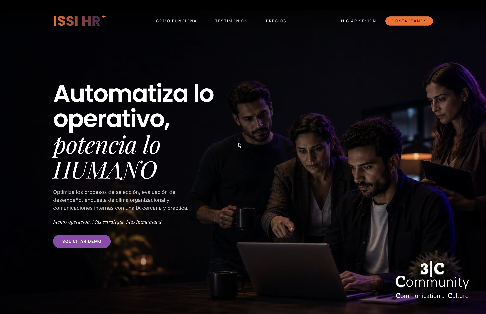
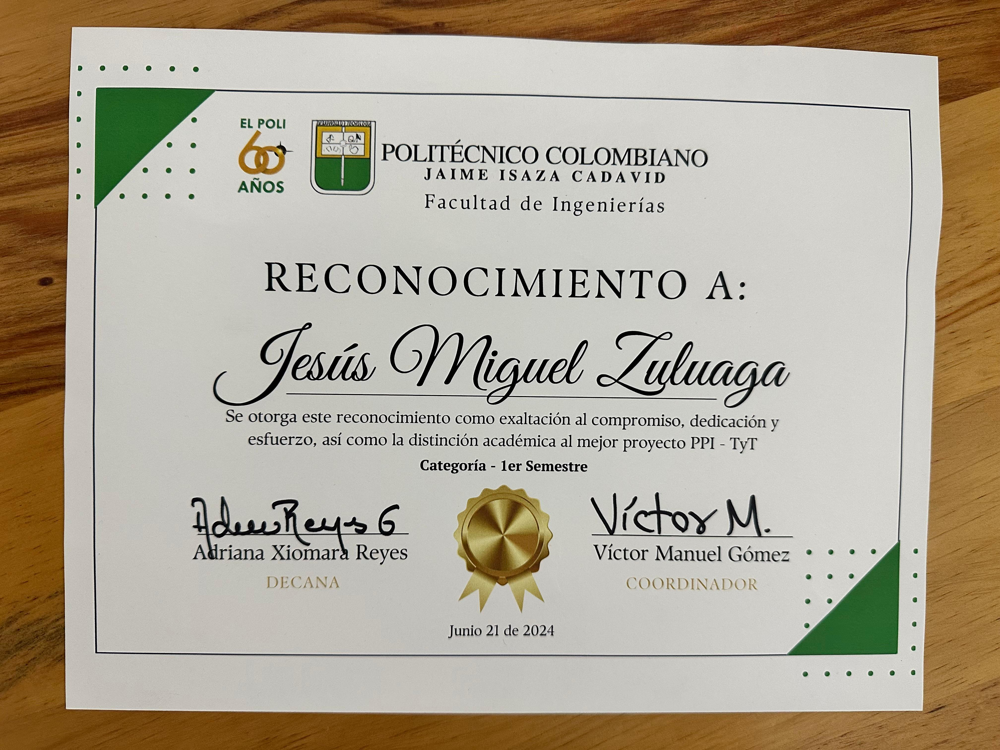
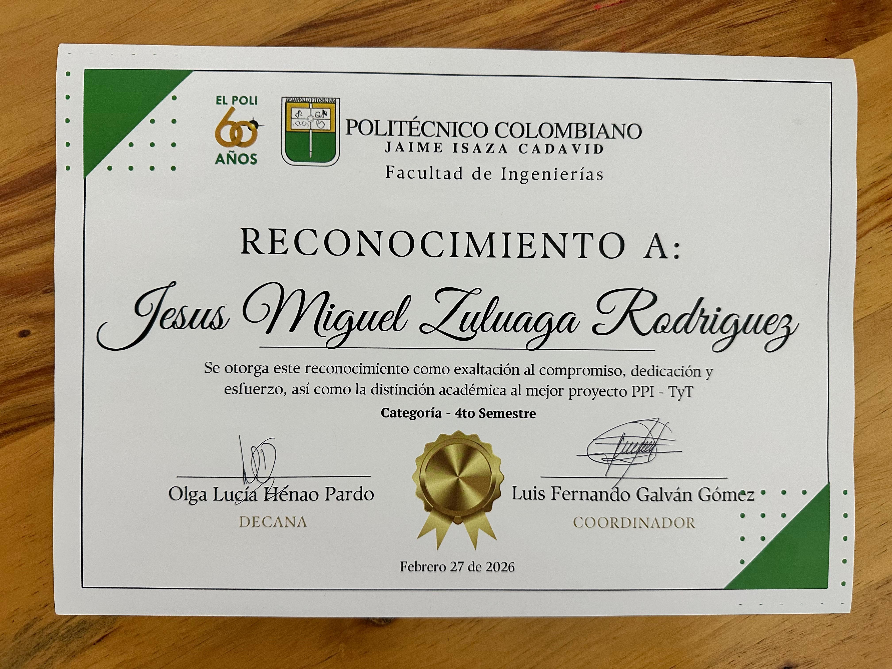

    <h1><b>Miguel Zuluaga</b></h1>
    
<b>Full-Stack Software Developer · Applied AI Systems</b>

    
<a href="README.md">Español</a> · <b>English</b>

    
    
<em>B.S. in Software Engineering (In Progress, 6th Semester) · Corporación Universitaria Minuto de Dios</em>

    
    
    

---

### Professional Summary

Software Developer specializing in applied AI systems, multi-agent orchestration, and backend architecture. Hands-on experience building production B2B SaaS platforms, implementing Clean Architecture, and integrating LLMs through the Model Context Protocol (MCP) and Retrieval-Augmented Generation (RAG) pipelines.

---

### Professional Experience

**3C Community S.A.S.** — Software Developer &nbsp;·&nbsp; Apr 2026 - Oct 2026

Development and operation of a multi-tenant B2B SaaS platform for recruitment, employee management, and performance reviews. Automated candidate/employee conversations over WhatsApp with AI agents and semantic CV ranking. Implemented identity and access control with Keycloak (OIDC) and per-tenant data isolation with PostgreSQL Row Level Security. Continuous deployment to production with Docker and GitHub Actions.

> `Next.js` &nbsp; `TypeScript` &nbsp; `FastAPI` &nbsp; `PostgreSQL (RLS)` &nbsp; `SQLAlchemy` &nbsp; `Redis` &nbsp; `Celery` &nbsp; `Qdrant` &nbsp; `Keycloak` &nbsp; `Docker` &nbsp; `GitHub Actions` &nbsp; `WhatsApp API (Meta/Twilio)` &nbsp; `RAG` &nbsp; `LiteLLM`

**Tigo Colombia** — Software Developer, Professional Internship &nbsp;·&nbsp; Oct 2025 - Apr 2026 &nbsp;·&nbsp; Medellín, Colombia (On-site)

Designed intelligent agents using LLMs to automate complex technical processes. Implemented following Clean Architecture, keeping the domain separate from infrastructure, with multi-model orchestration and automatic fallback to ensure service reliability.

> `MCP` &nbsp; `TShark` &nbsp; `LiteLLM` &nbsp; `Qdrant` &nbsp; `Docker` &nbsp; `Langfuse` &nbsp; `Python` &nbsp; `FastAPI` &nbsp; `FalkorDB` &nbsp; `Multi-Agent Systems` &nbsp; `Judge Systems` &nbsp; `Security Layers` &nbsp; `RAG Systems` &nbsp; `Redis` &nbsp; `Agentic Tools` &nbsp; `Skills`

**Audit Integral Advisors S.A.S.** — Technology Development Assistant &nbsp;·&nbsp; Jul 2024 - Aug 2025 &nbsp;·&nbsp; Remote

Developed technology solutions and automated internal processes. Data extraction and visualization in Python for auditing and organizational management information systems.

> `Python` &nbsp; `SQL` &nbsp; `Process Automation` &nbsp; `Data Visualization`

---

### Tech Stack

#### **Languages**
> `Python` &nbsp; `Java` &nbsp; `TypeScript` &nbsp; `JavaScript` &nbsp; `SQL`

#### **Backend & Frontend Systems**

> **Backend:** &nbsp; `FastAPI` &nbsp; `Django` &nbsp; `Spring Boot` &nbsp; `SQLAlchemy`

> **Frontend & UI:** &nbsp; `React` &nbsp; `Next.js` &nbsp; `TailwindCSS` &nbsp; `Bootstrap`

> **Game & Graphics:** &nbsp; `Pygame`

#### **AI Systems & Agent Engineering**

> **Orchestration & Frameworks:** &nbsp; `LangGraph` &nbsp; `LangChain` &nbsp; `LiteLLM (Groq / Gemini / OpenAI)`

> **Agent Architecture:** &nbsp; `Multi-Agent Systems` &nbsp; `Judge Systems` &nbsp; `Security Layers` &nbsp; `Input & Output Guardrails` &nbsp; `RAG Architectures`

> **Voice AI:** &nbsp; `Deepgram` &nbsp; `Cartesia`

> **Agent Tooling:** &nbsp; `Agentic Tools` &nbsp; `Skills` &nbsp; `Harness` &nbsp; `Function Calling`

#### **Observability, Protocols & DevOps**

> **LLM Observability:** &nbsp; `Langfuse`

> **Protocols & Interfaces:** &nbsp; `MCP (Model Context Protocol)` &nbsp; `Custom MCP Server` &nbsp; `AGUI`

> **Infrastructure & CI/CD:** &nbsp; `Docker` &nbsp; `Google Cloud Run` &nbsp; `AWS` &nbsp; `Hetzner` &nbsp; `Backblaze B2` &nbsp; `Cloudflare` &nbsp; `GitHub Actions`

> **Testing & Quality:** &nbsp; `pytest` &nbsp; `Vitest` &nbsp; `Playwright` &nbsp; `LLM Evals`

> **Identity & Auth:** &nbsp; `Keycloak (OIDC)`

#### **Data Infrastructure & Memory**

> **Relational:** &nbsp; `PostgreSQL (RLS)`

> **Vector & Graph:** &nbsp; `Qdrant` &nbsp; `pgvector` &nbsp; `FalkorDB`

> **Caching & Queuing:** &nbsp; `Redis` &nbsp; `Celery`

#### **Integrations & Network Analysis**

> **APIs & Messaging:** &nbsp; `WhatsApp API (Meta / Twilio)` &nbsp; `Wompi`

> **Automation & Packet Inspection:** &nbsp; `n8n` &nbsp; `TShark (Wireshark)`

---

## Featured Projects

<table>
<tr>
<td width="100%">
<h3 align="center">Cautelia</h3>

AI agent that takes car-accident reports and answers auto-policy questions by chat or in-browser voice calls, in Spanish and English. It cites the exact policy clause it relies on and never decides coverage or payments: a separate AI adjuster reads the report, the policy and the insurer's rules, checks the vehicle's reference value on the web and decides each case, explaining its reasoning. Built with React, TypeScript, FastAPI, LangGraph, Claude, PostgreSQL (RLS, pgvector), Deepgram, Cartesia, Langfuse, Google Cloud Run, Input & Output Guardrails and a Custom MCP Server.

</td>
</tr>
</table>

<table>
<tr>
<td width="50%">
<h3 align="center">ISSI HR</h3>

Multi-tenant B2B HR SaaS platform enabling companies to automate recruitment, talent management, and internal operations via conversational AI agents on WhatsApp.

</td>

<td width="50%">
<h3 align="center">WiFi Expert Agent</h3>

  

Multi-agent, multimodal web system converting raw Wireshark network captures into diagnostic reports using custom Skills, Agentic Tools, and a Judge System evaluation architecture.

</td>
</tr>
</table>

<table>
<tr>
<td width="33%">
<h3 align="center">Kakureya</h3>

Web application for food delivery operations and order tracking. Built with Python, Django, JavaScript, Bootstrap, AWS, Wompi API, and PostgreSQL.

🏆 Awarded Best Capstone Project — Third Semester Category

</td>

<td width="33%">
<h3 align="center">Forest Custodian</h3>

2D environmental education game built using Python and Pygame, featuring a modular code design and interactive mechanics.

🏆 Awarded Best Capstone Project — First Semester Category

</td>

<td width="33%">
<h3 align="center">Talky</h3>

Interactive language assistant providing automated conversational practice and lessons. Developed with React, Spring Boot, n8n, AWS, and TailwindCSS.

🏆 Awarded Best Capstone Project — Fourth Semester Category

</td>
</tr>
</table>

 

### 📊 GitHub Analytics

