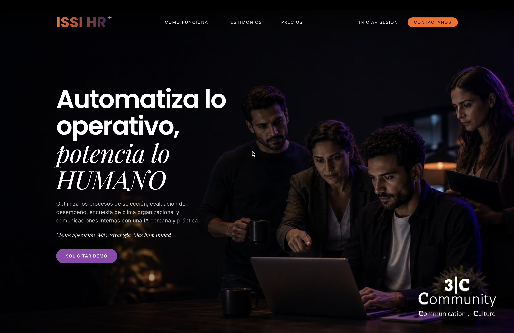

    <h1><b>Miguel Zuluaga</b></h1>
    
<b>Desarrollador de Software · Sistemas de IA aplicada</b>

    
<a href="README.md">English</a> · <b>Español</b>

    
    
<em>Ingeniería de Software (en curso, 6.º semestre) · Corporación Universitaria Minuto de Dios</em>

    
    
    

---

### Perfil profesional

Desarrollador de software enfocado en sistemas de IA aplicada, orquestación multiagente y arquitectura backend. Tengo experiencia práctica construyendo plataformas SaaS B2B en producción, aplicando Clean Architecture e integrando LLMs mediante Model Context Protocol (MCP) y flujos de generación aumentada por recuperación (RAG).

---

### Experiencia profesional

**3C Community S.A.S.** · Desarrollador de Software &nbsp;·&nbsp; abr. 2026 - oct. 2026

Desarrollo y operación de una plataforma SaaS B2B multiempresa para selección de personal, gestión de empleados y evaluación de desempeño. Automaticé la conversación con candidatos y empleados por WhatsApp con agentes de IA y ranking semántico de hojas de vida. Implementé identidad y control de accesos con Keycloak (OIDC) y aislamiento de datos por empresa con Row Level Security de PostgreSQL. Despliegue continuo a producción con Docker y GitHub Actions.

> `Next.js` &nbsp; `TypeScript` &nbsp; `FastAPI` &nbsp; `PostgreSQL (RLS)` &nbsp; `SQLAlchemy` &nbsp; `Redis` &nbsp; `Celery` &nbsp; `Qdrant` &nbsp; `Keycloak` &nbsp; `Docker` &nbsp; `GitHub Actions` &nbsp; `WhatsApp API (Meta/Twilio)` &nbsp; `RAG` &nbsp; `LiteLLM`

**Tigo Colombia** · Desarrollador de Software, prácticas profesionales &nbsp;·&nbsp; oct. 2025 - abr. 2026 &nbsp;·&nbsp; Medellín, Colombia (presencial)

Diseñé agentes inteligentes con LLMs para automatizar procesos técnicos complejos. Los implementé con Clean Architecture, separando el dominio de la infraestructura, con orquestación de varios modelos y fallback automático para mantener el servicio disponible.

> `MCP` &nbsp; `TShark` &nbsp; `LiteLLM` &nbsp; `Qdrant` &nbsp; `Docker` &nbsp; `Langfuse` &nbsp; `Python` &nbsp; `FastAPI` &nbsp; `FalkorDB` &nbsp; `Sistemas multiagente` &nbsp; `Judge Systems` &nbsp; `Security Layers` &nbsp; `Sistemas RAG` &nbsp; `Redis` &nbsp; `Agentic Tools` &nbsp; `Skills`

**Audit Integral Advisors S.A.S.** · Asistente de Desarrollo Tecnológico &nbsp;·&nbsp; jul. 2024 - ago. 2025 &nbsp;·&nbsp; Remoto

Desarrollo de soluciones tecnológicas y automatización de procesos internos. Extracción y visualización de datos en Python para sistemas de información de auditoría y gestión organizacional.

> `Python` &nbsp; `SQL` &nbsp; `Automatización de procesos` &nbsp; `Visualización de datos`

---

### Tecnologías

#### **Lenguajes**
> `Python` &nbsp; `Java` &nbsp; `TypeScript` &nbsp; `JavaScript` &nbsp; `SQL`

#### **Backend y frontend**

> **Backend:** &nbsp; `FastAPI` &nbsp; `Django` &nbsp; `Spring Boot` &nbsp; `SQLAlchemy`

> **Frontend e interfaz:** &nbsp; `React` &nbsp; `Next.js` &nbsp; `TailwindCSS` &nbsp; `Bootstrap`

> **Videojuegos y gráficos:** &nbsp; `Pygame`

#### **Sistemas de IA y agentes**

> **Orquestación y frameworks:** &nbsp; `LangGraph` &nbsp; `LangChain` &nbsp; `LiteLLM (Groq / Gemini / OpenAI)`

> **Arquitectura de agentes:** &nbsp; `Sistemas multiagente` &nbsp; `Judge Systems` &nbsp; `Security Layers` &nbsp; `Guardrails de entrada y salida` &nbsp; `Arquitecturas RAG`

> **Voz con IA:** &nbsp; `Deepgram` &nbsp; `Cartesia`

> **Herramientas de agentes:** &nbsp; `Agentic Tools` &nbsp; `Skills` &nbsp; `Harness` &nbsp; `Function Calling`

#### **Observabilidad, protocolos y DevOps**

> **Observabilidad de LLMs:** &nbsp; `Langfuse`

> **Protocolos e interfaces:** &nbsp; `MCP (Model Context Protocol)` &nbsp; `Servidor MCP propio` &nbsp; `AGUI`

> **Infraestructura y CI/CD:** &nbsp; `Docker` &nbsp; `Google Cloud Run` &nbsp; `AWS` &nbsp; `Hetzner` &nbsp; `Backblaze B2` &nbsp; `Cloudflare` &nbsp; `GitHub Actions`

> **Pruebas y calidad:** &nbsp; `pytest` &nbsp; `Vitest` &nbsp; `Playwright` &nbsp; `Evaluación de LLMs`

> **Identidad y autenticación:** &nbsp; `Keycloak (OIDC)`

#### **Datos y memoria**

> **Relacional:** &nbsp; `PostgreSQL (RLS)`

> **Vectorial y grafos:** &nbsp; `Qdrant` &nbsp; `pgvector` &nbsp; `FalkorDB`

> **Caché y colas:** &nbsp; `Redis` &nbsp; `Celery`

#### **Integraciones y análisis de redes**

> **APIs y mensajería:** &nbsp; `WhatsApp API (Meta / Twilio)` &nbsp; `Wompi`

> **Automatización e inspección de paquetes:** &nbsp; `n8n` &nbsp; `TShark (Wireshark)`

---

## Proyectos destacados

<table>
<tr>
<td width="100%">
<h3 align="center">Cautelia</h3>

Agente de IA que recibe reportes de choques y responde preguntas sobre la póliza de auto por chat o por llamada en el navegador, en español e inglés. Cita la cláusula exacta en la que se apoya y deja cada decisión de cobertura y de pagos a un ajustador humano. Hecho con React, TypeScript, FastAPI, LangGraph, Claude, PostgreSQL (RLS, pgvector), Deepgram, Cartesia, Langfuse, Google Cloud Run, guardrails de entrada y salida y un servidor MCP propio.

</td>
</tr>
</table>

<table>
<tr>
<td width="50%">
<h3 align="center">ISSI HR</h3>

Plataforma SaaS B2B multiempresa de recursos humanos que permite a las empresas automatizar la selección de personal, la gestión del talento y sus procesos internos con agentes de IA conversacionales en WhatsApp.

</td>

<td width="50%">
<h3 align="center">Agente Experto Wi-Fi</h3>

  

Sistema web multiagente y multimodal que convierte capturas de red de Wireshark en reportes de diagnóstico, con Skills propias, Agentic Tools y una arquitectura de evaluación con Judge System.

</td>
</tr>
</table>

<table>
<tr>
<td width="33%">
<h3 align="center">Kakureya</h3>

Aplicación web para la operación de domicilios de comida y el seguimiento de pedidos. Hecha con Python, Django, JavaScript, Bootstrap, AWS, API de Wompi y PostgreSQL.

🏆 Certificado mejor proyecto PPI T&T, categoría tercer semestre

</td>

<td width="33%">
<h3 align="center">Forest Custodian</h3>

Videojuego 2D de educación ambiental hecho con Python y Pygame, con código modular y mecánicas interactivas.

🏆 Certificado mejor proyecto PPI T&T, categoría primer semestre

</td>

<td width="33%">
<h3 align="center">Talky</h3>

Asistente interactivo para practicar inglés con conversación y lecciones automatizadas. Hecho con React, Spring Boot, n8n, AWS y TailwindCSS.

🏆 Certificado mejor proyecto PPI T&T, categoría cuarto semestre

</td>
</tr>
</table>

 

### 📊 Estadísticas de GitHub

